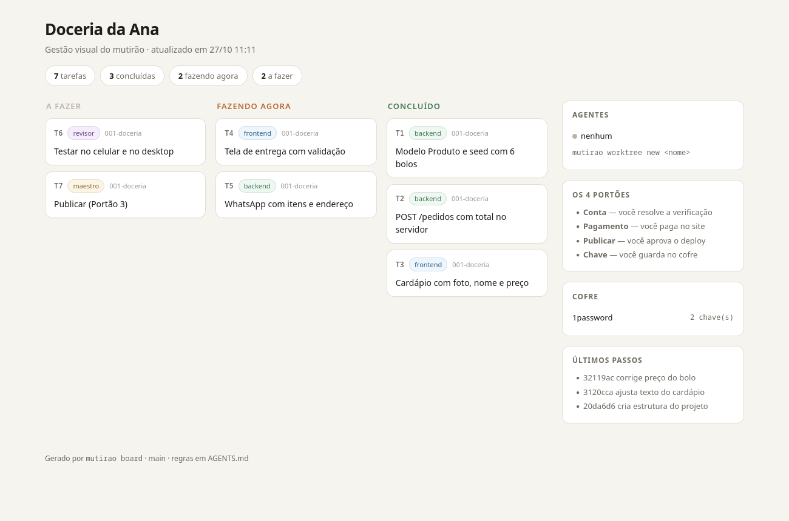

<div align="center">

# Mutirão

**Vibe coding para quem nunca programou.**
Uma equipe de IAs trabalhando em mutirão — você só conversa.

[](https://github.com/Padecodigo/mutirao/actions/workflows/ci.yml)
[](LICENSE)
[](docs/como-comecar.md)

</div>

---

> ### Cole o link no chat da sua IA
>
> Duas formas. **Com o prompt pronto** (mais previsível — o agente já vai direto
> ao ponto):
>
> ```
> Leia o START.md de https://github.com/Padecodigo/mutirao e configure
> este projeto com o Mutirão. Depois me pergunte o que eu quero construir.
> ```
>
> **Ou só o link** — aí a IA lê o [START.md](START.md) e faz **uma** pergunta:
> você quer **usar** o Mutirão para construir algo, ou **desenvolver** o próprio
> Mutirão? Da resposta sai o caminho, sem tutorial antes da hora.
>
> **Se você é uma IA lendo isto:** leia [START.md](START.md) e faça a pergunta
> de abertura — ou, se a pessoa já pediu "instale e configure", siga o roteiro
> "Instale e configure" de lá.

---

## O problema

Ferramentas de vibe coding assumem que você sabe o que é um terminal, uma branch
e uma chave de API. Para quem **não programa**, o primeiro erro é o fim: a pessoa
não sabe se quebrou algo, não sabe desfazer, e desiste.

## A ideia

Um repositório que transforma o chat em uma equipe de obra:

- **Maestro** — conversa com você em português e escreve a spec
- **Frontend / Backend** — constroem em paralelo, cada um na sua cópia do projeto
- **Revisor** — confere contra a spec, testa e junta

E, em vez de "a IA faz tudo", **a IA faz tudo e para em 4 lugares** — porque
esses 4 não são dela:

| # | Parada | Por que | Quem faz |
|---|---|---|---|
| 1 | **Criar conta** | CAPTCHA, SMS e termos de uso proíbem automação | você resolve a verificação |
| 2 | **Pagar** | cartão exige o titular (3DS); é ato jurídico seu | você paga no site |
| 3 | **Publicar** | é o momento em que o mundo vê | você aprova |
| 4 | **Mexer em chave** | segredo é responsabilidade do dono | você guarda no cofre |

Fora desses quatro momentos, você pede e a IA executa.

---

## Como funciona

```
     você  ──conversa──▶  MAESTRO  ──spec + contratos──┐
                                                      │
                        ┌──────────────┬──────────────┤
                        ▼              ▼              ▼
                    FRONTEND        BACKEND        (mais)
                    worktree        worktree       worktree
                        └──────────────┼──────────────┘
                                       ▼
                                   REVISOR ──▶ resultado testado
                                       │
                                  portões 1–4 ──▶ você
```

As chaves nunca entram no projeto: o cofre guarda o valor, o repositório guarda
só o nome, e o programa recebe a chave na hora de rodar.

```bash
mutirao vault add STRIPE_SECRET_KEY   # o projeto declara o que precisa
mutirao vault run -- npm run dev      # a chave entra sem aparecer
```

---

## Começar em 3 comandos

```bash
git clone https://github.com/Padecodigo/mutirao.git ~/mutirao
~/mutirao/mutirao init ~/meu-projeto && cd ~/meu-projeto
./mutirao start "site de doceria que recebe pedido no WhatsApp"
```

O último comando imprime o pedido de abertura para você colar na sua IA
(Claude Code, Codex, Gemini CLI, Cursor…). A partir daí, é conversa — e o
`./mutirao board` abre o quadro para você acompanhar.

Guia completo, sem pressupor nada: **[docs/como-comecar.md](docs/como-comecar.md)**

---

## O que tem dentro

```
START.md                  o roteiro de quem só recebeu o link (a porta de entrada)
AGENTS.md                 a constituição — todo agente lê isto primeiro
CLAUDE.md                 atalho para ferramentas que procuram esse nome
llms.txt                  índice da documentação para agentes
.agents/                  as personas: maestro, frontend, backend, revisor, portões
.specify/                 spec → plano → contratos → tarefas (e o exemplo)
tools/
  board.sh                quadro visual: a fazer · fazendo · concluído
  worktree.sh             uma cópia do projeto por agente (paralelo sem conflito)
  vault.sh                cofre plugável: 1Password, Bitwarden, Infisical, Doppler
  guard.sh                trava de commit que recusa segredos
  init.sh                 cria um projeto novo a partir do kit
mutirao                   a CLI única
docs/                     guias em linguagem simples
examples/doceria/         um exemplo completo: spec, contratos e tarefas
tests/smoke.sh            os testes do próprio kit
```

Calma, você não precisa entender essa árvore. Ela existe para a IA não se perder.

---

## Gestão visual

Tudo o que está acontecendo tem um lugar para ser visto:

```bash
./mutirao board          # gera o quadro e abre no navegador (estático)
./mutirao board --serve  # interativo: arraste os cartões, grava no tasks.md
./mutirao board --watch  # estático, atualizando sozinho a cada 5 segundos
```



A página é **um arquivo só**: sem internet, sem login. Ela lê o
`.specify/specs/*/tasks.md` e as worktrees dos agentes — ou seja, mostra o
estado real do projeto, não uma lista que alguém esqueceu de atualizar.

No modo `--serve`, arrastar um cartão grava a marca no `tasks.md` na hora, e o
botão **copiar pedido** entrega o comando pronto para colar no chat da IA.
Rodar isso é um processo local (python3 da biblioteca padrão), escutando só em
`127.0.0.1`. Sem python3 na máquina, o Mutirão cai sozinho no modo estático —
nada deixa de funcionar, só perde o arrastar.

Para o quadro saber o andamento, as tarefas usam três marcas:

| Marca | Significado | Quem muda |
|---|---|---|
| `- [ ]` | a fazer | Maestro, ao planejar |
| `- [>]` | fazendo agora | o agente, ao começar |
| `- [x]` | concluído | o agente, ao terminar |

---

## Segurança em uma linha

Chave no cofre, nome no projeto, valor só na memória do processo — e um hook que
recusa commit de segredo. Detalhes e o que fazer se vazar:
**[docs/seguranca-e-cofre.md](docs/seguranca-e-cofre.md)**

---

## Limites honestos

- **Não cria conta nem paga por você.** Não é limitação técnica: é o que impede
  a conta de ser banida e o cartão de vazar. Ver
  [docs/contas-e-pagamentos.md](docs/contas-e-pagamentos.md).
- **Paralelo custa mais.** Três agentes gastam 2–4× um agente só. Use quando as
  frentes forem independentes de verdade.
- **Não substitui você decidir.** O Mutirão não sabe o que você quer. Ele sabe
  construir o que você disser.
- **Ainda é v0.1.** O kit, as regras e as ferramentas funcionam; o que falta é
  maturidade de uso real. Veja [issues](https://github.com/Padecodigo/mutirao/issues).

---

## Para quem é

Para quem tem uma ideia e não tem um programador: a doceria, o personal, o
advogado, o estudante, o pequeno comércio. Se você já programa, o
[AGENTS.md](AGENTS.md) e o [.specify/](.specify/README.md) servem como ponto de
partida — mas você não é o público.

---

## Contribuir

Ideias, correções e novos "portões" são bem-vindos. Leia
[CONTRIBUTING.md](CONTRIBUTING.md) e rode `bash tests/smoke.sh` antes de abrir PR.

Segurança: [SECURITY.md](SECURITY.md).

---

## Licença

MIT — use, copie, venda, adapte. Veja [LICENSE](LICENSE).

**O que você constrói com o Mutirão é seu, inteiro.** Sem royalty, sem
participação, sem licença sobre o resultado. O kit é ferramenta, não sócio:
pode vender o projeto, fechar o código ou abrir — sem pedir nada a ninguém.

Escolhemos MIT de propósito por dois motivos. Primeiro, quem usa não pode ficar
preso: uma licença restritiva no repositório apareceria na auditoria de quem
compra o negócio e desvalorizaria a venda. Segundo, um método só vale se
circular — a alternativa (cobrar percentual do faturamento do usuário) não é
exequível contra quem não tem advogado, e espantaria exatamente o público que o
projeto atende.
